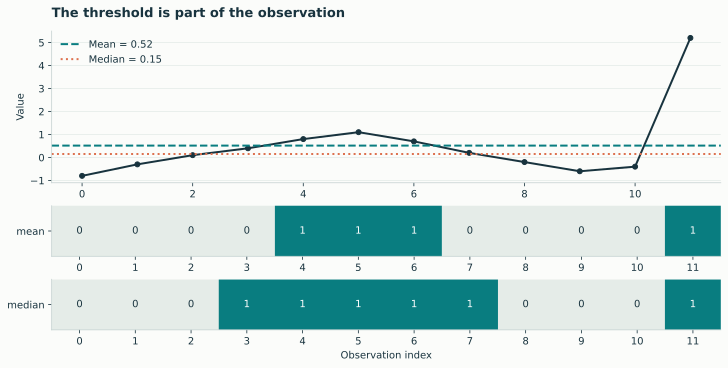
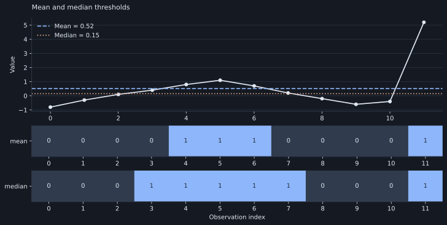
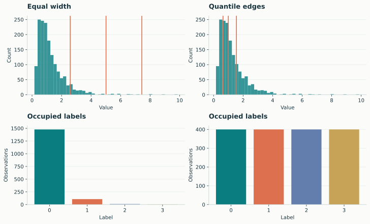
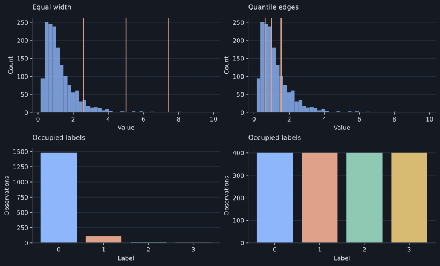

# Thresholds and bins

These examples compare thresholding and binning rules on fixed input data.

## Mean and median thresholds

[{ .plot }](../assets/figures/thresholds.svg "Open full-size figure")

[{ .plot }](../assets/figures/dark/thresholds.svg "Open full-size figure")

```python
import numpy as np
import lzsuite as lzs

values = np.array([-0.8, -0.3, 0.1, 0.4, 0.8, 1.1, 0.7, 0.2, -0.2, -0.6, -0.4, 5.2])
mean_labels = lzs.discretize(values, "mean")
median_labels = lzs.discretize(values, "median")
mean_labels, median_labels
```

Both rules put equality in category 0. The outlier influences the fitted mean
more than the median in this sample. The resulting binary arrays therefore
represent different threshold crossings.

[SVG](../assets/figures/thresholds.svg) · [PNG](../assets/figures/thresholds.png)

## Equal-width and quantile bins

[{ .plot }](../assets/figures/binning.svg "Open full-size figure")

[{ .plot }](../assets/figures/dark/binning.svg "Open full-size figure")

```python
rng = np.random.default_rng(1729)
values = rng.lognormal(mean=0, sigma=0.65, size=1600)
width = lzs.discretize(values, "bins", n_bins=4)
quantile = lzs.discretize(values, "quantile", n_bins=4)
np.bincount(width, minlength=4), np.bincount(quantile, minlength=4)
```

Equal-width bins preserve evenly spaced value ranges. Quantile bins instead
fit empirical distribution cut points. Repeated values can create ties and
collapse edges. The gallery's full reproduction script uses one sequential RNG
stream, so this standalone snippet demonstrates the method without reproducing
its exact histogram sample.

!!! note "Interpret the prepared sequence"
    The default log base uses the number of occupied labels, not the requested
    number of bins. Use `log_base=2` when you want a fixed common unit.

[SVG](../assets/figures/binning.svg) · [PNG](../assets/figures/binning.png)

Continue to the [discretization guide](../guide/discretization.md) or
[custom shared bin edges](../guide/custom-methods.md).
