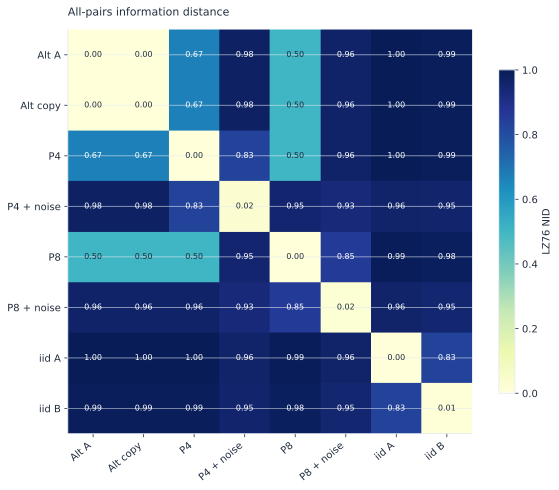
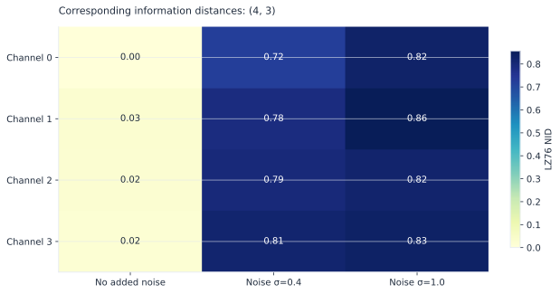

# Maps of recurring patterns

A distance matrix can make a collection easier to inspect, provided each row's
identity, encoding, and preprocessing are retained.

## All pairs within a collection

{ .plot }

The alternate-sequence pair is an exact copy. P4 and P8 use period-four and
period-eight motifs; their noisy variants independently flip symbols with
probability 0.03. The two independent samples are distinct fair-binary draws.
NID compares pattern sharing through concatenation counts, not samplewise error.

```python
import numpy as np
import lzsuite as lzs

rng = np.random.default_rng(1729)
a = np.tile([0, 0, 1, 1], 512)
b = a ^ (rng.random(a.size) < 0.03)
c = rng.integers(0, 2, size=a.size)
sequences = np.stack([a, b, c], axis=1)
lzs.distance(sequences)  # (3, 3)
```

The diagonal is calculated, not overwritten. If a downstream algorithm requires
a zero diagonal, apply that as a separate, documented transformation.

[SVG](../assets/figures/distance-matrix.svg) · [PNG](../assets/figures/distance-matrix.png)

## One counterpart per position

{ .plot }

This comparison keeps the original channel/trial layout instead of expanding
it into a square matrix. Three columns add different noise amplitudes, then each
float sequence is mean-binarized independently. Their initial signal realizations
already differ; the figure is an illustration rather than a calibrated noise curve.

```python
recordings = rng.normal(size=(2000, 4, 3))
other = recordings + 0.3 * rng.normal(size=recordings.shape)
lzs.distance(recordings, other).shape  # (4, 3)
```

A shared category codebook is essential. Independent remapping could accidentally
make unrelated vocabularies look the same. Both modes preserve category meanings
through shared encoding and accept the same discretization settings.

[SVG](../assets/figures/paired-distances.svg) · [PNG](../assets/figures/paired-distances.png)
