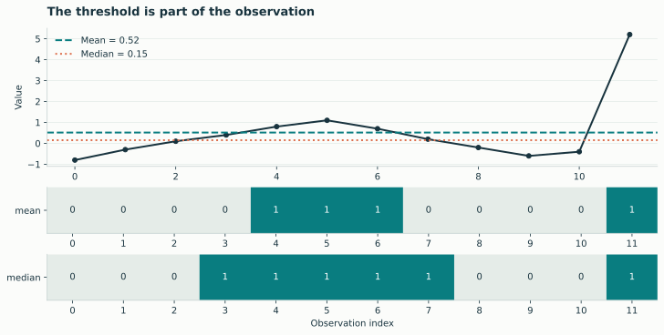
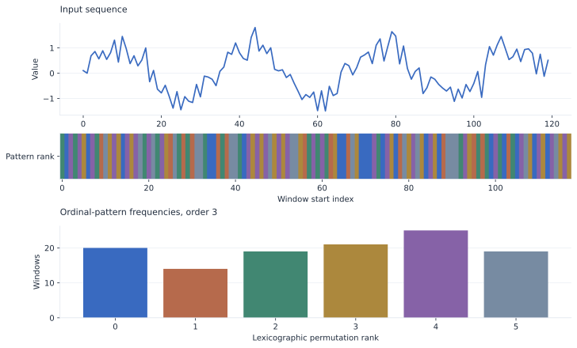
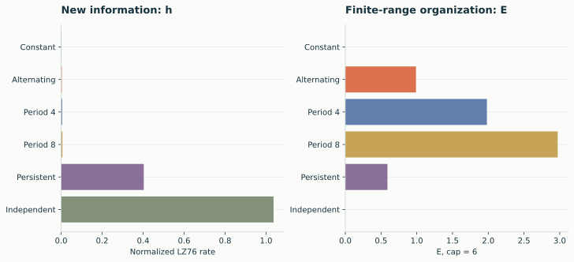
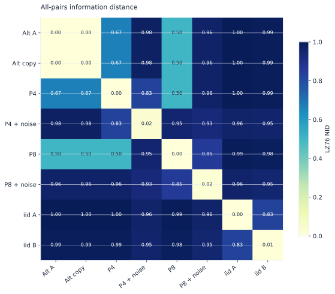
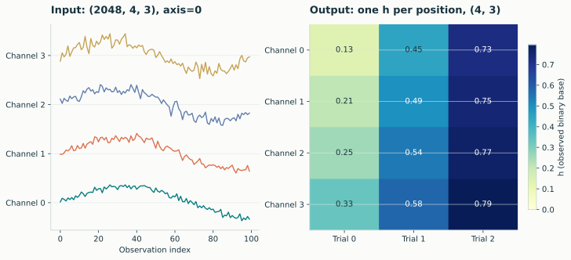
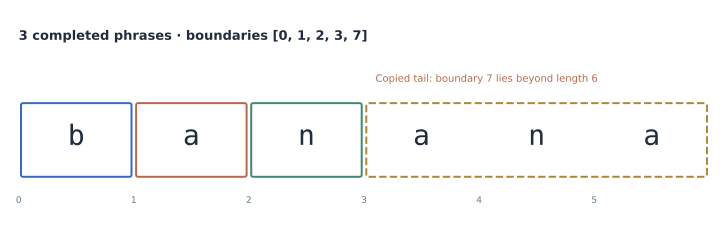

# The visual field guide

Explore how representation, ordering, range, and array shape affect the result.
These figures use seeded synthetic data and the actual lzsuite backend. They
illustrate specific finite samples, not universal calibration curves.

<a class="lz-gallery-card" href="discretization/"><strong>Thresholds & bins</strong>Representations, outliers, and occupancy</a>
<a class="lz-gallery-card" href="permutations/"><strong>Ordinal patterns</strong>From local orderings to symbolic sequences</a>
<a class="lz-gallery-card" href="structure/"><strong>Structure & randomness</strong>h, E, profiles, and sample lengths</a>
<a class="lz-gallery-card" href="distances/"><strong>Similarity maps</strong>All-pairs and corresponding distances</a>
<a class="lz-gallery-card" href="workflows/"><strong>Array workflows</strong>Custom rules, axes, and process agreement</a>
<a class="lz-gallery-card" href="reproduce/"><strong>Open, reproducible figures</strong>Source, seeds, exports, and provenance</a>

Each chapter includes small snippets you can try in IPython. For exact data,
settings, and plotting code, use [the reproduction instructions](reproduce.md).
