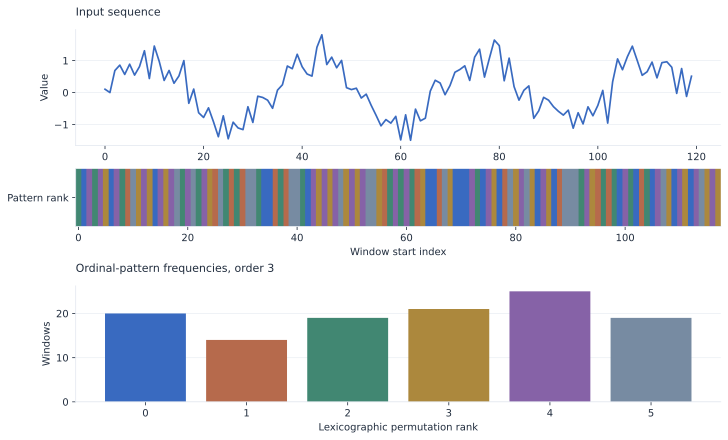

# Local orderings become symbols

Ordinal representations preserve how values are ordered inside a window, rather
than the exact amplitudes or which side of a global threshold they occupy.

{ .plot }

## Follow three short windows

```python
import lzsuite as lzs

values = [3.0, 1.0, 2.0, 4.0, 0.0]
lzs.discretize(values, "permutation", order=3).tolist()
# [3, 0, 4]
```

| Window | Indices in increasing value order | Rank |
|---|---|---:|
| `[3, 1, 2]` | `(1, 2, 0)` | 3 |
| `[1, 2, 4]` | `(0, 1, 2)` | 0 |
| `[2, 4, 0]` | `(2, 0, 1)` | 4 |

Labels are lexicographic permutation ranks. Equal values are ordered by their
position, earlier first, so ties are deterministic. This tie rule is part of the
representation and should be recorded for quantized or repeated observations.

## Window spacing and output length

```python
import numpy as np

signal = np.sin(np.linspace(0, 20, 1000))
labels = lzs.discretize(signal, "permutation", order=3, delay=2)
labels.shape  # (996,)
```

A delayed window spans `(order - 1) * delay + 1` original observations. Windows
still advance one original sample at a time. The output has
`n - (order - 1) * delay` entries, and the window must fit in the signal.

```python
entropy = lzs.h(
    signal,
    discretization="permutation",
    discretization_kwargs={"order": 3, "delay": 2},
)
```

This is an LZ76 analysis **of the ordinal-pattern sequence**. It is not the
Shannon entropy of the pattern histogram. Those are different measurements.

## Pattern count grows quickly

Order 3 admits 6 patterns; order 5 admits 120; order 6 admits 720. The discretizer
can produce integer ranks beyond 255. Analysis warns and merges categories if
more than 256 distinct labels are actually observed. High orders also require
more data to observe a useful range of patterns.

[SVG](../assets/figures/permutations.svg) · [PNG](../assets/figures/permutations.png)
