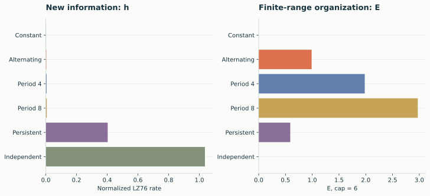
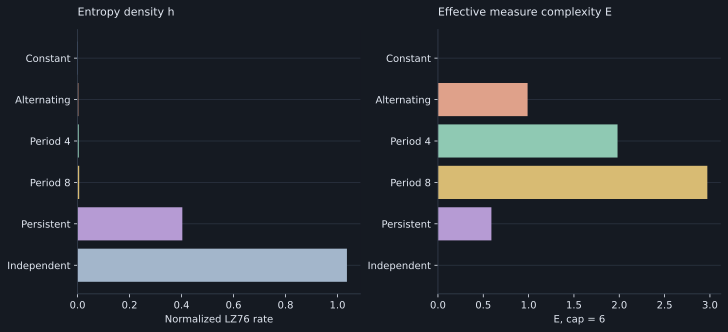
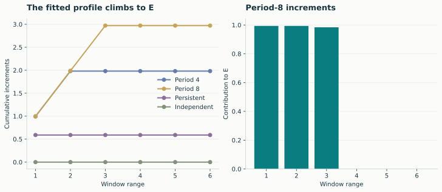
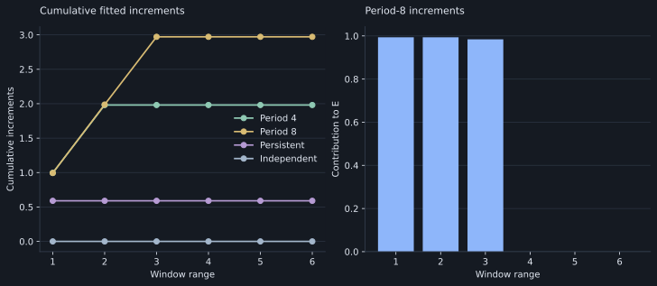
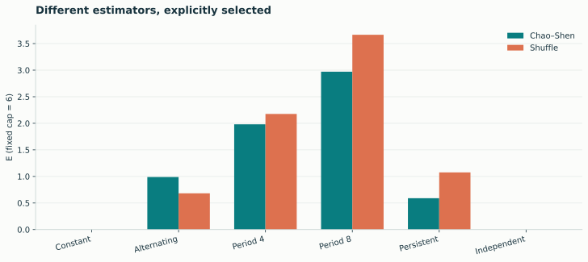
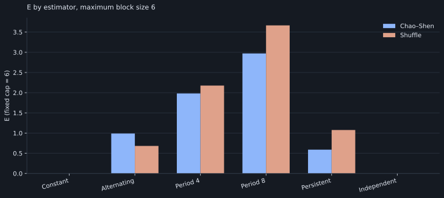
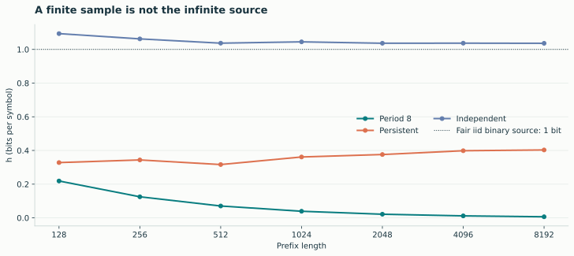
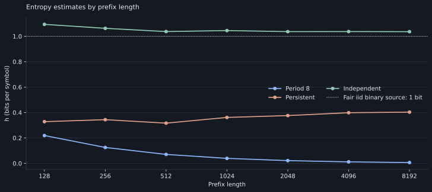

# Entropy and complexity

These examples compare normalized LZ76 entropy density h and effective measure
complexity E for binary sequences with different temporal dependencies.

## h and E for six binary sequences

[{ .plot }](../assets/figures/measures.svg "Open full-size figure")

[{ .plot }](../assets/figures/dark/measures.svg "Open full-size figure")

All six inputs have 8192 binary observations. E uses a fixed cap of 6. The
persistent process changes state with probability 0.08 at each step; the
independent sample draws fair binary values. These labels describe the data
construction, not estimator guarantees.

```python
import numpy as np
import lzsuite as lzs

periodic = np.tile([0, 0, 0, 1, 0, 1, 1, 1], 1024)
independent = np.random.default_rng(1729).integers(0, 2, size=8192)
for sequence in [periodic, independent]:
    result = lzs.lz76(sequence, max_block_size=6)
    print(result["h"], result["emc"]["value"])
```

[SVG](../assets/figures/measures.svg) · [PNG](../assets/figures/measures.png)

## Fitted profiles and increments

[{ .plot }](../assets/figures/emc-profiles.svg "Open full-size figure")

[{ .plot }](../assets/figures/dark/emc-profiles.svg "Open full-size figure")

The profile is fitted jointly. Its increments are nonnegative and sum to the
score, but they are not separate, independent estimates of each scale's
contribution. Use the actual cap and selected estimator when interpreting them.

[SVG](../assets/figures/emc-profiles.svg) · [PNG](../assets/figures/emc-profiles.png)

## Estimator comparison

[{ .plot }](../assets/figures/estimators.svg "Open full-size figure")

[{ .plot }](../assets/figures/dark/estimators.svg "Open full-size figure")

```python
chao, _ = lzs.emc(periodic, method="chao-shen", max_block_size=6)
shuffle, _ = lzs.emc(periodic, method="shuffle", max_block_size=6)
```

The estimators use different raw profiles. This chart is a comparison of their
operational outputs, not evidence that one is universally more accurate. See
[the E guide](../guide/emc.md) for the formulas and range policies.

[SVG](../assets/figures/estimators.svg) · [PNG](../assets/figures/estimators.png)

## Sequence-length dependence

[{ .plot }](../assets/figures/convergence.svg "Open full-size figure")

[{ .plot }](../assets/figures/dark/convergence.svg "Open full-size figure")

Short estimates can exceed one. The curves use overlapping prefixes, not
independent realizations, and the dotted source-rate reference is not an exact
finite-sample target. Repeated recordings or suitable ensembles are needed to
assess sampling variation.

[SVG](../assets/figures/convergence.svg) · [PNG](../assets/figures/convergence.png)
