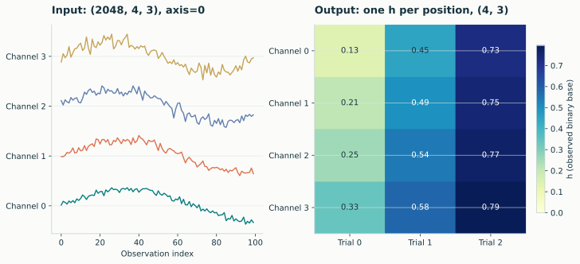
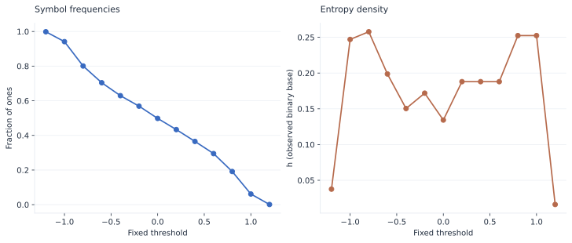
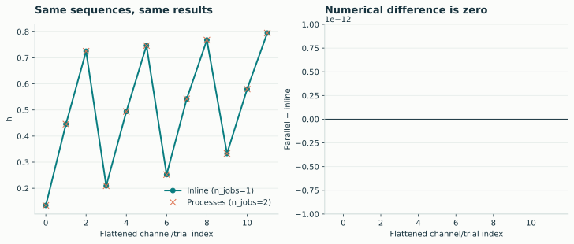
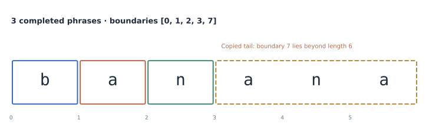

# From a scientific layout to repeatable results

## Preserve your channel/trial dimensions

{ .plot }

The gallery data are shaped `(2048, 4, 3)`. Only the observation axis is removed
by `h`, so each output position still identifies one channel and one trial.

```python
import numpy as np
import lzsuite as lzs

x = np.random.default_rng(42).normal(size=(2048, 4, 3))
lzs.h(x).shape  # (4, 3)
```

[SVG](../assets/figures/axes.svg) · [PNG](../assets/figures/axes.png)

## Ask a different question with a custom threshold

{ .plot }

```python
def fixed_threshold(values, *, level=0.0):
    return (values > level).astype(np.uint8)


lzs.h(
    x,
    discretization=fixed_threshold,
    discretization_kwargs={"level": 0.5},
)
```

The signal is unchanged; its representation changes. Record that rule alongside
your results. A shared fixed threshold preserves different information from a
mean fitted independently to each recording.

[SVG](../assets/figures/custom-threshold.svg) · [PNG](../assets/figures/custom-threshold.png)

## Distribute calculations without changing their meaning

{ .plot }

```python
serial = lzs.h(x, n_jobs=1)
parallel = lzs.h(x, n_jobs=2)
np.testing.assert_array_equal(serial, parallel)
```

This demonstrates result agreement, not a performance improvement. Actual speed
and memory use depend on input size, operation, method, hardware, and process
startup. See the [parallel guide](../guide/parallel.md) for the execution budget.

[SVG](../assets/figures/parallel-agreement.svg) · [PNG](../assets/figures/parallel-agreement.png)

## Inspect a symbolic parse

{ .plot }

```python
count, boundaries = lzs.factorization(np.array(list("banana")))
count, boundaries  # (3, [0, 1, 2, 3, 7])
```

The attempted final end is retained even beyond the sequence. See the
[result conventions](../reference/results.md) before interpreting boundary lists.

[SVG](../assets/figures/factorization.svg) · [PNG](../assets/figures/factorization.png)
