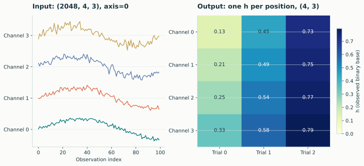
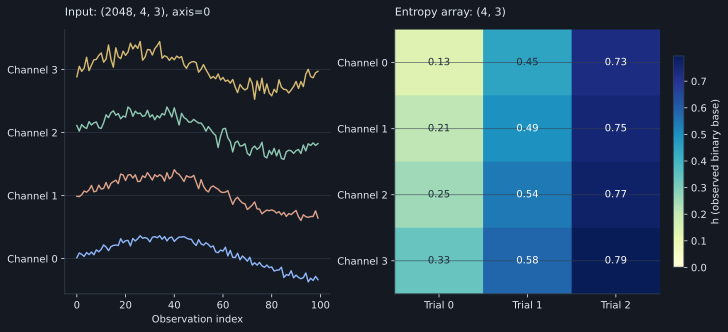

# Arrays and axes

The sequence axis contains successive observations. Each combination of
positions on the other axes identifies one sequence.

[{ .plot }](../assets/figures/axes.svg "Open full-size figure")

[{ .plot }](../assets/figures/dark/axes.svg "Open full-size figure")
<p class="caption">Synthetic observations shaped (2048, 4, 3), analyzed with axis=0. Each channel/trial position contributes its own temporal sequence. The heatmap shows entropy density for each sequence.</p>

## The shape rule

For input `(1000, 4, 3)` and `axis=0`:

- 12 sequences are analyzed.
- Each sequence has 1000 observations before discretization.
- A scalar measurement returns shape `(4, 3)`.

```python
import numpy as np
import lzsuite as lzs

x = np.random.default_rng(42).normal(size=(1000, 4, 3))
h = lzs.h(x)
h[2, 1]  # channel 2, trial 1
```

The sequence at that position is `x[:, 2, 1]`. Binarization fits its mean from
those observations alone, unless another method is supplied.

## Selecting a different axis

| Input | Axis | Sequence count | Observations per sequence | Scalar result |
|---|---:|---:|---:|---|
| `(1000, 4, 3)` | 0 | 12 | 1000 | `(4, 3)` |
| `(1000, 4, 3)` | 1 | 3000 | 4 | `(1000, 3)` |
| `(1000, 4, 3)` | 2 | 4000 | 3 | `(1000, 4)` |

Changing the selected axis changes the sequence length and the observations
being compared. Very short sequences give unstable entropy-rate estimates.

```python
last_axis = np.moveaxis(x, 0, -1)
np.allclose(lzs.h(x), lzs.h(last_axis, axis=-1))  # True
```

Negative axes and noncontiguous slices work. The library does not require
contiguous storage and does not modify the input array.

## One sequence versus a singleton collection

```python
lzs.h(x[:, 0, 0])  # float: input is 1D
lzs.h(x[:, :1, :1])  # ndarray with shape (1, 1)
```

There is no automatic squeezing of batch dimensions. This makes downstream
indexing predictable even when only one channel or trial remains.

## Structured results

| Call | 1D input | Multiple sequences |
|---|---|---|
| `h` | `float` | Float array |
| `complexity` | `int` | Integer array |
| `factorization` | `(count, boundaries)` | Object array of tuples |
| `emc` | `(score, increments)` | Score array plus object array of lists |
| `lz76` | Dictionary | Object array of dictionaries |

Object arrays are intentional: factor lists and automatically selected E
profiles can differ in length. Index the batch position first, then the
structured result:

```python
results = lzs.lz76(x, max_block_size=6)
results[2, 1]["emc"]["summands"]
```

## Empty and invalid shapes

A zero-length sequence axis is rejected. An empty collection with a nonempty
sequence axis is allowed: input `(1000, 0, 3)` gives an empty scalar result of
shape `(0, 3)`. Scalar inputs such as `3.5` or `np.array(3.5)` are not sequences.

See [distance shapes](distances.md) for all-pairs comparisons, which
comparison flattens batch positions into rows and columns.
