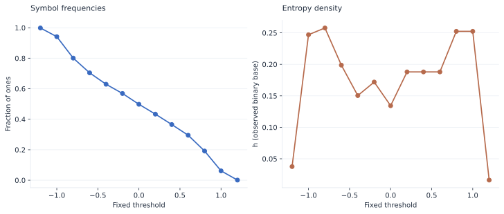

# Bring your own representation

A custom discretizer is a Python callable receiving one numeric 1D array and
returning one nonempty 1D array of integer labels. It may shorten the signal.
It needs no class, inheritance, or output-length declaration.

## Pass a function directly

```python
import numpy as np
import lzsuite as lzs


def threshold(values, *, level=0.0):
    return (values > level).astype(np.uint8)


x = np.random.default_rng(42).normal(size=(2000, 4))
lzs.h(x, discretization=threshold, discretization_kwargs={"level": 0.5})
```

The input is a copy, so even an in-place custom method cannot alter the caller's
observations. The output contract is validated each time the method is invoked.
A float array of labels is rejected, even if its entries happen to be whole
numbers: return an integer or boolean dtype explicitly.

## Register a reusable name

```python
lzs.register_discretizer("threshold", threshold, replace=True)
lzs.h(x, discretization="threshold", discretization_kwargs={"level": 0.5})
```

Registration is local to the current Python process. `replace=True` makes a
notebook cell safe to rerun and is required when deliberately overwriting a
name, including a built-in.

```python
@lzs.register_discretizer("every_other", replace=True)
def every_other(values):
    return (values[::2] > 0).astype(np.uint8)


lzs.available_discretizers()
lzs.h(x, discretization="every_other")
```

Methods are invoked in the parent process before native calculations are
parallelized. Local functions, closures, and notebook definitions therefore do
not need to be pickleable.

## Shared fixed bin edges

```python
edges = np.array([-0.5, 0.0, 0.5])


def fixed_bins(values):
    return np.digitize(values, edges, right=False)


lzs.distance(x, discretization=fixed_bins)
```

All sequences use the same physical thresholds. In contrast, the built-in
`bins` and `quantile` methods fit their edges separately to every sequence.
Record the edges with your results; they define what each category means.

## Understand sensitivity

{ .plot }
<p class="caption">Both panels use the same oscillatory signal. The left panel describes its symbolic representation; the right shows actual LZ76 measurements. A representation change can move a score without changing the underlying observations.</p>

Match representation rules across groups or explain explicitly why per-sequence
fitting is part of the comparison. Avoid choosing a threshold just because it
produces an attractive outcome.
