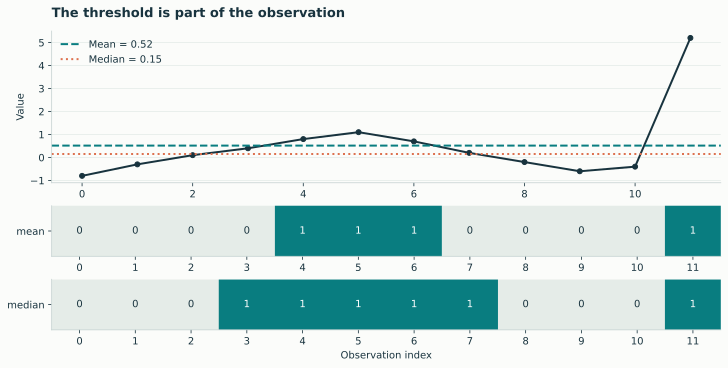
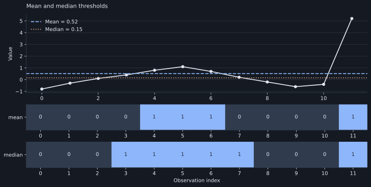
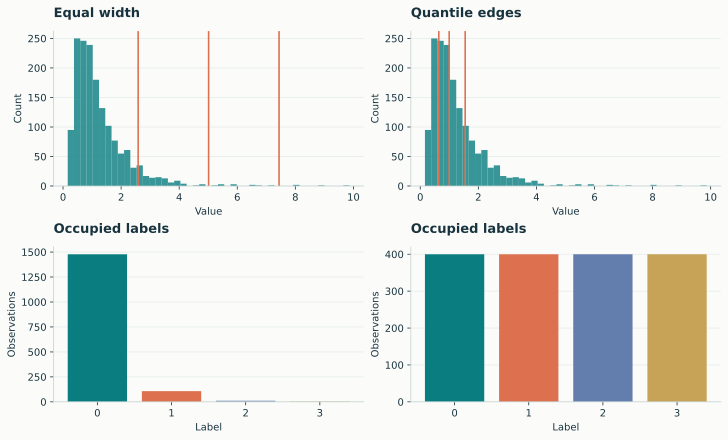
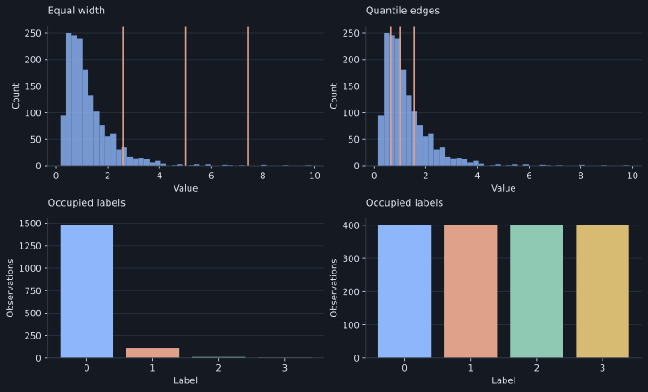

# Discretization

Discretization is part of the scientific observation. A threshold asks whether a
value is high or low; bins preserve levels; ordinal patterns preserve local
orderings. These representations answer different questions about the same data.

[{ .plot }](../assets/figures/thresholds.svg "Open full-size figure")

[{ .plot }](../assets/figures/dark/thresholds.svg "Open full-size figure")
<p class="caption">One large observation shifts the mean. Equality belongs to label 0 for both threshold methods. The binary rows are generated by the actual built-ins.</p>

## Direct use on a 1D signal

```python
import numpy as np
import lzsuite as lzs

x = np.array([0.0, 1.0, 2.0, 3.0, 9.0])
lzs.available_discretizers()
```

```python
lzs.discretize(x, "mean")  # [0, 0, 0, 0, 1]
lzs.discretize(x, "median")  # [0, 0, 0, 1, 1]
```

All methods receive finite, nonempty, real numeric 1D inputs. Their output must
be a nonempty 1D array of integer or boolean labels. They can change length.
Strings, complex values, objects, NaN, and infinity are rejected.

## Equal-width and quantile bins

```python
lzs.discretize(x, "bins", n_bins=4)
lzs.discretize(x, "quantile", n_bins=4)
```

[{ .plot }](../assets/figures/binning.svg "Open full-size figure")

[{ .plot }](../assets/figures/dark/binning.svg "Open full-size figure")
<p class="caption">The upper panels show observed distributions and fitted internal edges. Lower panels show category counts. Quantile bins aim for balanced occupancy; repeated values can prevent equal populations.</p>

Equal-width edges span each sequence's minimum and maximum. Quantile edges use
NumPy's default linear quantile interpolation. Values on internal edges enter
the higher bin. Repeated quantile edges collapse; requested bins and occupied
bins can differ. Constant sequences produce only zero labels.

!!! note "Per-sequence fitting versus shared edges"
    Built-in bins are fitted independently to every sequence. This compares
    relative patterns within each recording. To preserve differences in
    absolute levels, use shared fixed edges through a [custom method](custom-methods.md).

## Ordinal patterns

```python
x = np.array([3.0, 1.0, 2.0, 4.0, 0.0])
lzs.discretize(x, "permutation", order=3).tolist()  # [3, 0, 4]
```

A window of `order` observations is sorted, and its ordering receives a
lexicographic permutation rank. Successive windows advance one original sample.
`delay` controls spacing *inside* each window. Output length is
`len(x) - (order - 1) * delay`. Ties use position, earlier first.

This does not calculate permutation entropy: it produces a symbolic sequence
that can then be analyzed with LZ76. See the [ordinal-pattern gallery](../gallery/permutations.md).

## Inside an array calculation

```python
recordings = np.random.default_rng(42).normal(size=(2000, 4, 3))
entropy = lzs.h(
    recordings,
    discretization="quantile",
    discretization_kwargs={"n_bins": 4},
)
```

The method runs separately on every sequence. An explicit numeric method
overrides automatic mean binarization, including on integer inputs. Its options
are passed through `discretization_kwargs`.

## Existing symbols

Integer, boolean, and string-array elements are already categories. Signed or
large integer labels do not need to be contiguous; they are encoded internally.
Each string element is one symbol even if it contains multiple characters.

```python
labels = np.array(["rest", "move", "wait", "rest"] * 64)
lzs.h(labels)
```

For numerical categories stored as floats, explicitly map them to integer
labels before analysis. Do not blindly truncate continuous values or cast
arbitrary integers to `uint8`: that can silently change category meanings.

Above 256 distinct prepared categories, analysis emits `RuntimeWarning` and
continues with merged byte codes. Discretization itself can produce more labels;
the warning happens when measurements encode them for the backend.
