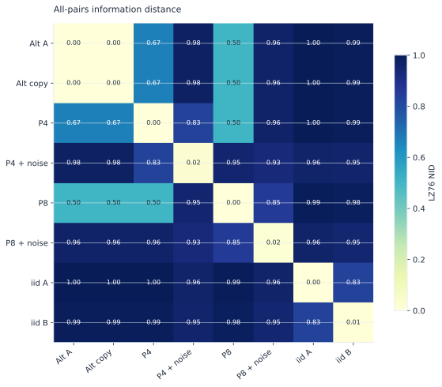
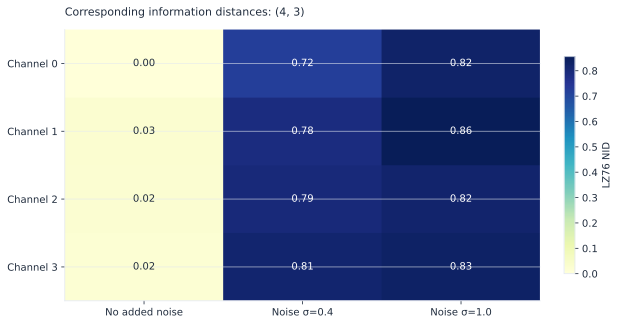

# Compare the patterns sequences share

LZ76 information distance compares factor counts for X, Y, XY, and YX:

```text
d(X,Y) = max(C(XY) - C(X), C(YX) - C(Y)) / max(C(X), C(Y))
```

The ratio is symmetric. It compares recurring patterns, not point-by-point
amplitude differences or edit operations. No logarithm base enters the formula.

## One array: all pairs

```python
import numpy as np
import lzsuite as lzs

rng = np.random.default_rng(42)
data = rng.integers(0, 2, size=(2000, 4, 3))
matrix = lzs.distance(data)
matrix.shape  # (12, 12)
```

{ .plot }

Matrix order is C-order flattening of the batch shape. For `(4, 3)`, position
`(channel, trial)` maps to row `channel * 3 + trial`. Each unordered pair is
calculated once and mirrored. Actual self-distances are retained; an identical
sequence can have nonzero distance to itself at finite length.

!!! note "A zero diagonal is a downstream choice"
    If a clustering method requires one, make a copy and explicitly apply
    `np.fill_diagonal(copy, 0)`. Record that transformation. lzsuite preserves
    the computed result rather than silently changing it.

## Two arrays: corresponding pairs

```python
other = rng.integers(0, 2, size=(1500, 4, 3))
paired = lzs.distance(data, other)
paired.shape  # (4, 3)
```

{ .plot }
<p class="caption">Each position compares one original sequence with its counterpart. Float inputs are independently mean-binarized before measuring NID. The no-added-noise column still retains actual finite-sequence self-distances.</p>

Shapes outside the sequence axis must match exactly; there is no broadcasting.
Sequence lengths may differ, including after discretization. This mode does not
compute all cross-pairs between the two collections.

```python
lzs.distance(data[:, 0, 0], other[:, 0, 0])  # float
lzs.nid(data[:, 0, 0], other[:, 0, 0])  # same function, alias
lzs.distance(data[:, 0, 0]).shape  # (1, 1): all-pairs mode
```

## Category meanings must match

The library builds a shared codebook across the inputs. It does not independently
map each sequence's first category to zero: that could make disjoint vocabularies
look identical. Both operands must be numeric categories or both must use the
same string representation (Unicode or bytes).

Built-in float discretization is fitted separately per sequence. If absolute
levels matter, use a [custom fixed rule](custom-methods.md) with shared edges.
Matched lengths and sampling schemes make scientific comparisons easier to
interpret, even though unequal lengths are accepted.

## Scaling

For M sequences, there are `M * (M + 1) / 2` unique computed pairs, including the
diagonal. Result storage is M-by-M. Native NID requires several factorizations
per pair, so benchmark a representative subset before a large collection.
`n_jobs` distributes independent pairs across processes, not across machines.
