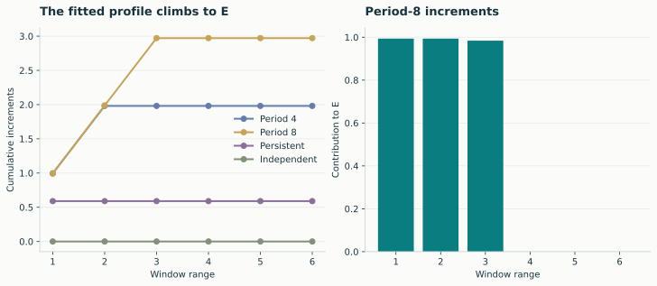
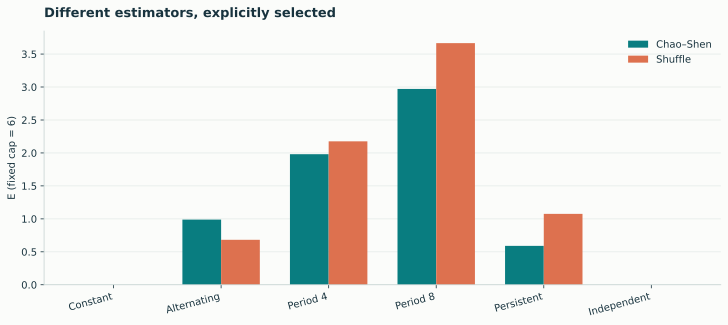

# Effective measure complexity E

E complements entropy density by examining organization across different byte
window ranges. The returned profile explains how the fitted score increases
as longer ranges are included.

```python
import lzsuite as lzs

periodic = [0, 0, 0, 1, 0, 1, 1, 1] * 1024
score, increments = lzs.emc(periodic, max_block_size=6)
score, increments
```

```python
import numpy as np

np.cumsum(increments)  # fitted profile; its final level is E
```

{ .plot }

The increments are nonnegative and sum to E, up to floating-point rounding.
They come from a fitted profile, so they should not be read as independent
measurements of isolated scales.

## The default: Chao–Shen

The backend counts overlapping length-l windows, estimates their block entropy
with Chao–Shen, subtracts `l × h_LZ`, and fits a nonnegative, nondecreasing profile.
E is its final level. The unprojected first-range contrast is retained as
`multi_information` in the full result.

```python
full = lzs.lz76(periodic, max_block_size=6)
full["emc"]  # method, value, summands, actual range, raw first contrast
```

When all observed windows are singletons, the backend falls back to the
empirical plug-in entropy. Sparse sampling is still a limitation, not something
covered by a blanket accuracy guarantee.

## Automatic versus explicit ranges

Automatic Chao–Shen range selection starts with the largest l satisfying
`l × sigma**l <= n`, with a minimum of one. Sigma is the observed alphabet size,
floored at two. The raw profile is then truncated at its earliest maximum.

A positive `max_block_size` retains the entire requested ladder, including any
later decline before fitting. Therefore a larger explicit cap does not simply
append more positive contributions to an unchanged estimate.

Use fixed caps to separate sequence-length effects from automatic-range changes.
For matched data, inspect several scientifically relevant caps rather than
assuming the default is a universal correlation-length detector.

## The alternative: shuffle

```python
shuffle_score, shuffle_increments = lzs.emc(periodic, method="shuffle", max_block_size=6)
```

The shuffle estimator constructs deterministic block-swapped surrogates, measures
their LZ76 factor counts, and fits a different raw profile. Its default range
rule also differs. Equal caps do not make the two methods numerically equivalent.

{ .plot }
<p class="caption">The same inputs, binary units, and cap 6 are used for both calls. Record the selected method in saved results and comparisons. Repeat calls on identical prepared bytes and settings are deterministic.</p>

For a batch, scores have the shape with the sequence axis removed, and profiles
are stored in an object array. Auto-selected profile lengths can differ:

```python
recordings = np.tile(periodic, (3, 1)).T
scores, profiles = lzs.emc(recordings, n_jobs=1)
profiles[0]  # first sequence's list of increments
```
