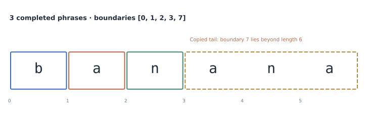
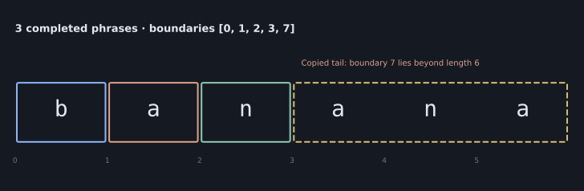
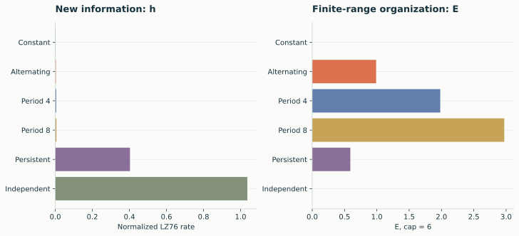
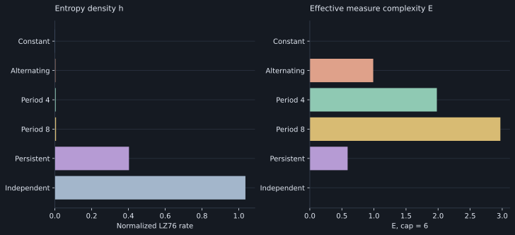
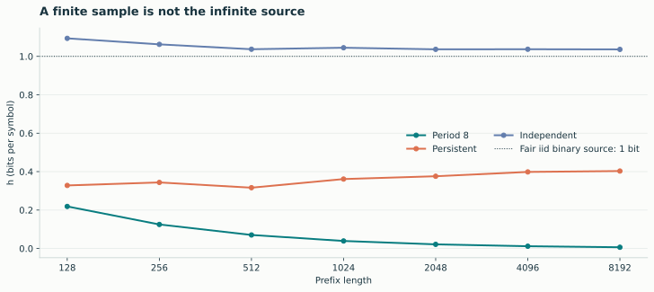
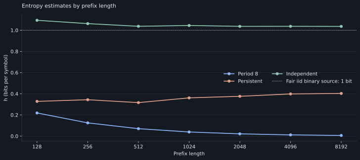

# LZ76 measurements

LZ76 follows repeated substrings, rather than only counting individual symbols.
Its factor count C describes how often parsing introduces a completed new phrase.
The normalized entropy density h turns that count into a finite-sequence
entropy-rate estimate.

## Factorization

```python
import numpy as np
import lzsuite as lzs

sequence = np.array(list("banana"))
count, boundaries = lzs.factorization(sequence)
count, boundaries  # (3, [0, 1, 2, 3, 7])
```

[{ .plot }](../assets/figures/factorization.svg "Open full-size figure")

[{ .plot }](../assets/figures/dark/factorization.svg "Open full-size figure")

The visible pieces are `b`, `a`, `n`, and `ana`. The final `ana` is copied from
an earlier occurrence; attempting to extend it reaches beyond the end. The
backend keeps that attempted boundary 7 while reporting three completed phrases.

```python
visible_pieces = [
    "".join(sequence[start : min(stop, len(sequence))])
    for start, stop in zip(boundaries[:-1], boundaries[1:])
]
```

Do not infer the count by subtracting one from the boundary-list length. Constant
inputs have their own convention: count 1 and boundaries `[0, 1, n]`.

## Entropy density h

For prepared length n > 1, factor count C, and log base b:

```text
h = C × log_b(n) / n
```

```python
lzs.h([0, 1, 0, 1, 0, 1, 0, 1])  # 0.75
lzs.h(sequence, log_base=2)  # explicit bit units
```

The default base is the distinct-symbol count in each prepared sequence, floored
at two. This is separate from the original float dtype or requested bin count:
only categories actually present after discretization determine the default.

## Entropy density and effective measure complexity

[{ .plot }](../assets/figures/measures.svg "Open full-size figure")

[{ .plot }](../assets/figures/dark/measures.svg "Open full-size figure")
<p class="caption">8192 symbols per sequence, common binary units, E cap 6. “Persistent” is a synthetic binary process that flips with probability 0.08. “Independent” is a seeded fair binary sample. These are finite measurements, not universal reference values.</p>

Raw complexity grows with length, so compare it at matched lengths. h estimates
new information per symbol; E examines finite-range organization. Neither is
an all-purpose measure of how scientifically interesting a source is.

## Finite-length behavior

[{ .plot }](../assets/figures/convergence.svg "Open full-size figure")

[{ .plot }](../assets/figures/dark/convergence.svg "Open full-size figure")
<p class="caption">Each curve uses prefixes of one seeded sequence. The dotted line is the one-bit entropy rate of a fair iid binary source, not an exact finite-sample target. h can exceed one; lzsuite does not clip it.</p>

Check multiple lengths and independent observations. Prefixes overlap, so they
are not independent replicates. Keep representation and normalization fixed when
studying length effects. See [scientific interpretation](../concepts/interpretation.md)
for estimator limits and reproducibility advice.
