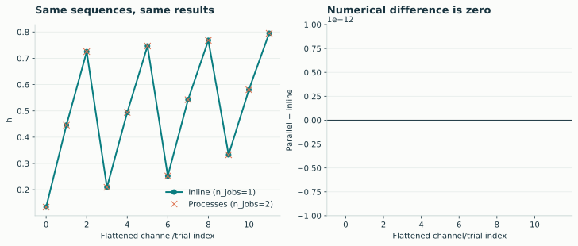
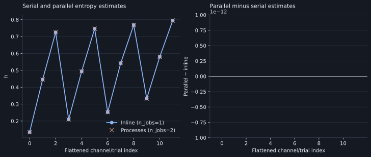

# Parallel execution

The default is **up to four worker processes**, capped by available CPUs and the
number of independent calculations. Processes are provided by joblib's loky
backend and work from scripts, IPython, and notebooks.

```python
import numpy as np
import lzsuite as lzs

x = np.random.default_rng(42).normal(size=(10000, 16))
lzs.h(x)  # up to four processes
lzs.h(x, n_jobs=2)  # up to two
lzs.h(x, n_jobs=-1)  # available CPUs, capped by calculation count
lzs.h(x, n_jobs=1)  # inline: no process pool
```

Workers are reused across calls. The first process-based call can be slower
because it includes startup, while later calls can reuse existing workers.
Preparation, validation, encoding, and custom discretization happen in the caller
before native work is distributed.

## Python processes and native Rayon threads

| Execution path | Independent sequence calculations | Rayon configuration |
|---|---|---|
| Multiple processes | Distributed over workers | One thread per worker |
| `n_jobs=1` | Inline in the caller | Caller settings unchanged |
| One calculation or one available CPU | Inline in the caller | Caller settings unchanged |

Each child sets `RAYON_NUM_THREADS=1` before importing the native extension.
Other managed native thread pools are also limited to one per worker. The
caller's environment and initialized Rayon pool are not changed.

This avoids four processes each starting a full native worker pool. The serial
path still lets lzcomplexity use its own Rayon workers for suitable internal
operations. Python's GIL does not prevent separate processes from calculating
at the same time.

## Numerical agreement

```python
serial = lzs.h(x, n_jobs=1)
parallel = lzs.h(x, n_jobs=2)
np.testing.assert_array_equal(serial, parallel)
```

[{ .plot }](../assets/figures/parallel-agreement.svg "Open full-size figure")

[{ .plot }](../assets/figures/dark/parallel-agreement.svg "Open full-size figure")
<p class="caption">Entropy estimates and residuals for the same twelve sequences with n_jobs=1 and n_jobs=2. All residuals are zero.</p>

## Process overhead and memory use

Small sequences can cost less to analyze than to send to a process. Larger pools
also increase working memory: the backend constructs suffix/LCP/LPF arrays,
block histograms, or surrogate buffers. Distance matrices add quadratic output
storage. Use a smaller `n_jobs` when CPU work is cheap or memory is constrained.

For a timing study, report hardware, input length/alphabet, selected operation,
method/cap, worker count, package versions, warm-up policy, and repeated timings.
Separate process startup from warmed repeated calls and do not generalize one
machine's timings into a universal speedup claim.

## Custom methods in interactive sessions

Locally defined functions are fine because they run before native task dispatch:

```python
def threshold(values):
    return (values > 0).astype(np.uint8)


lzs.h(x, discretization=threshold, n_jobs=2)
```

The pipeline does not parallelize discretization itself. See the
[execution reference](../reference/analysis.md) for function parameters.
