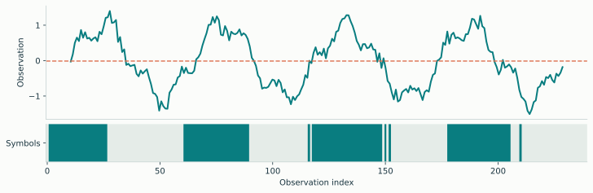
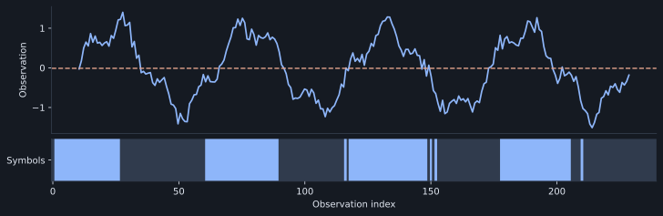
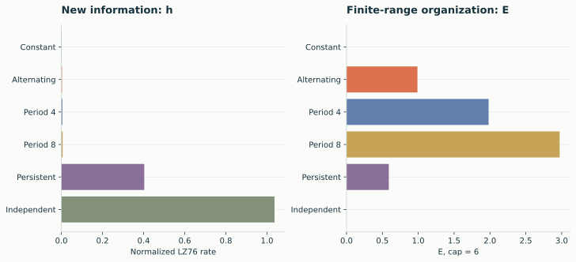
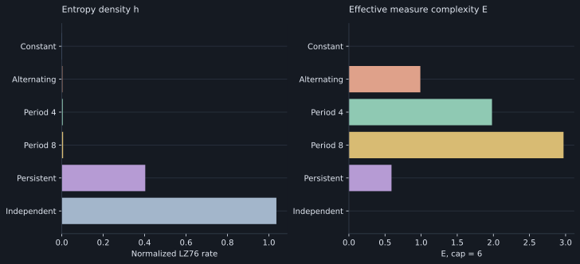
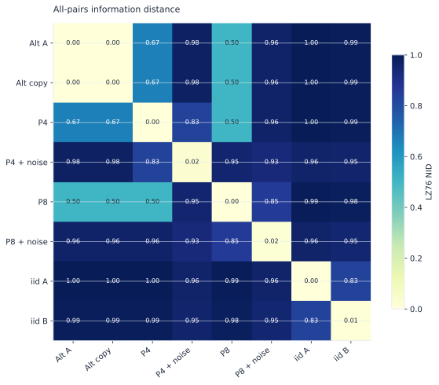
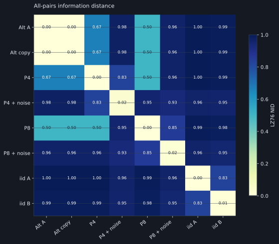

<div class="landing-page" markdown="1">

<section class="landing-hero" aria-labelledby="landing-title" markdown="1">
<div class="landing-intro" markdown="1">

<h1 id="landing-title">Lempel–Ziv analysis<br>for NumPy arrays.</h1>

<p class="landing-description">Discretize continuous signals, calculate complexity and entropy, and compare sequences along any array axis.</p>

<div class="landing-actions">
<a class="landing-primary" href="guide/quickstart/">Documentation <span aria-hidden="true">→</span></a>
<a class="landing-secondary" href="api/">API reference</a>
</div>

<div class="landing-install" markdown="1">

```sh
pip install lzsuite
```

</div>

<p class="landing-requirements">Python 3.10+ <span aria-hidden="true">·</span> NumPy <span aria-hidden="true">·</span> MIT license</p>

</div>
<div class="landing-example" markdown="1">

<div class="landing-panel-heading"><span>Mean binarization</span><a href="guide/discretization/">Discretization methods <span aria-hidden="true">↗</span></a></div>
<div class="landing-signal">


</div>
<div class="landing-code" markdown="1">

```python
import numpy as np
import lzsuite as lzs

rng = np.random.default_rng(42)
data = rng.normal(size=(2000, 4, 3))

entropy = lzs.h(data, axis=0)
entropy.shape  # (4, 3)
```

</div>
<div class="landing-panel-note"><code>2,000 samples × 4 channels × 3 trials</code><span>12 sequences, one result per channel and trial.</span></div>

</div>
</section>

<nav class="landing-topics" aria-label="Library features">
<a href="guide/discretization/"><code>discretize</code><h2>Discretization</h2><p>Mean, median, equal-width bins, quantile bins, and ordinal patterns. Register custom methods or pass a callable.</p><span>Methods and parameters <span aria-hidden="true">→</span></span></a>
<a href="guide/arrays/"><code>h · complexity · emc</code><h2>Array calculations</h2><p>Select the sequence axis. Preserve channel and trial dimensions in the output. Distribute independent calculations across processes.</p><span>Arrays and execution <span aria-hidden="true">→</span></span></a>
<a href="guide/distances/"><code>distance · nid</code><h2>Information distance</h2><p>Calculate all-pairs distance matrices or compare corresponding sequences in two arrays using a shared symbol encoding.</p><span>Distance calculations <span aria-hidden="true">→</span></span></a>
</nav>

<section class="landing-results" aria-labelledby="examples-title">
<div class="landing-section-heading"><h2 id="examples-title">Numerical examples</h2><a href="gallery/">All examples <span aria-hidden="true">→</span></a></div>
<div class="landing-results-grid">
<a class="landing-result" href="gallery/structure/">
<div class="landing-result-image"></div>
<h3>Entropy and effective measure complexity</h3><p>Compare constant, periodic, persistent, and independent sequences. Inspect estimator choice and sequence-length dependence.</p>
</a>
<a class="landing-result" href="gallery/distances/">
<div class="landing-result-image"></div>
<h3>Pairwise information distance</h3><p>Compare sequences in a collection and corresponding pairs across arrays. Examine matrix ordering and finite-length self-distances.</p>
</a>
</div>
</section>

<section class="landing-documentation" aria-labelledby="documentation-title">
<div><h2 id="documentation-title">Documentation</h2><p>Usage guides, function signatures, result conventions, and reproducible figure source.</p><p>Numerical calculations are provided by <a href="https://github.com/pleros-ai/lzcomplexity">lzcomplexity</a>. lzsuite adds array handling, discretization, and process-level parallelism.</p></div>
<ul>
<li><a href="guide/installation/">Installation <span aria-hidden="true">→</span></a></li>
<li><a href="guide/quickstart/">Quickstart <span aria-hidden="true">→</span></a></li>
<li><a href="guide/">User guide <span aria-hidden="true">→</span></a></li>
<li><a href="api/">API reference <span aria-hidden="true">→</span></a></li>
<li><a href="concepts/interpretation/">Scientific interpretation <span aria-hidden="true">→</span></a></li>
<li><a href="contributing/">Contributing <span aria-hidden="true">→</span></a></li>
</ul>
</section>

</div>
